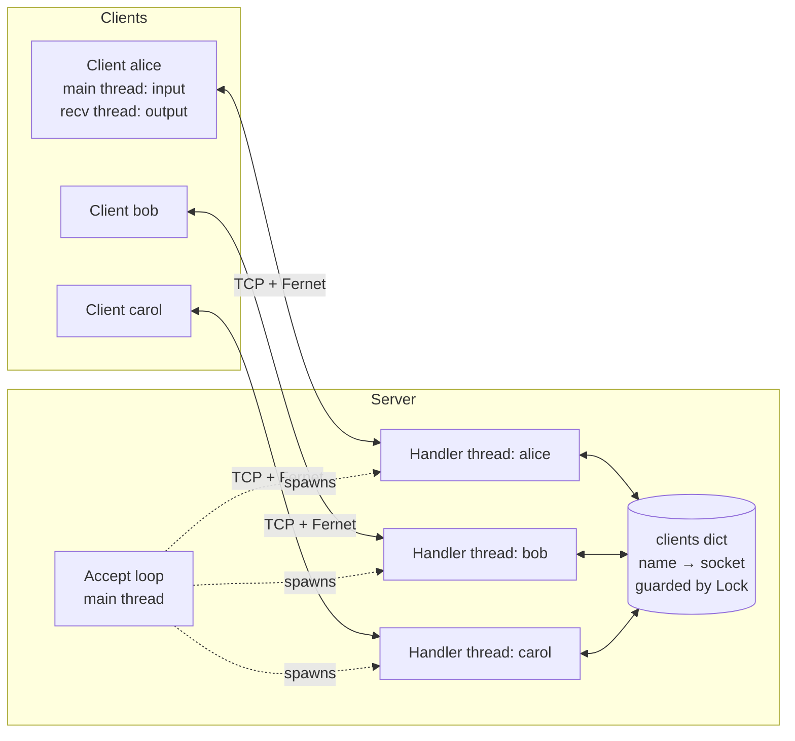
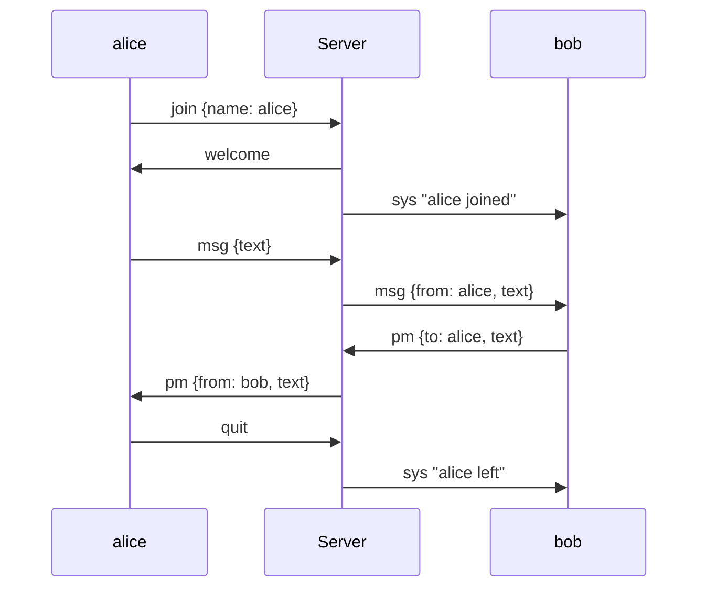

# TCP Messenger: Technical Report

**Authors:** _<your names>_

## 1. Overview

TCP Messenger is a client–server chat application built directly on Python's `socket` API over TCP. A central server accepts many concurrent clients and supports two chat modes:

1. **Broadcast:** a message from one client is relayed to all other connected clients.
2. **Private (1-to-1):** a message addressed to a username is delivered only to that client.

On top of that, all traffic in both chat modes is **encrypted on the wire**. We measured the processing overhead and the latency it adds, on local loopback and over a real Wi-Fi network.

## 2. Architecture



- **Server** (`server.py`): the main thread blocks on `accept()`. Each new connection gets a dedicated daemon **handler thread**, which reads frames from its client and routes them.
- **Client** (`client.py`): the main thread reads keyboard input and sends. A background **receiver thread** blocks on `recv()` and prints incoming messages, so a user can receive messages while typing.
- The client's networking is the `ChatClient` class, which hands incoming messages to an `on_message` callback. The terminal UI is a thin layer on top, so a GUI (for example Tkinter) can reuse `ChatClient` unchanged.

## 3. Protocol design

### 3.1 Framing

TCP is a byte stream, not a message stream: one `send()` can arrive split across several `recv()` calls, or several messages can arrive in one `recv()`. Every message is therefore framed as:

```
+----------------------+---------------------------+
| length (4 bytes, BE) | payload (length bytes)    |
+----------------------+---------------------------+
```

`recv_frame()` reads exactly 4 bytes, then loops until exactly `length` bytes have arrived. Frames over 1 MiB are rejected, so a malformed or malicious length cannot make the server allocate unbounded memory.

### 3.2 Messages

The payload is a JSON object (encrypted when encryption is on):

| `type` | Direction | Fields | Meaning |
|---|---|---|---|
| `join` | C→S | `name` | first message; registers a username |
| `welcome` | S→C | `text` | join accepted |
| `msg` | C→S, S→C | `text`, `from`* | broadcast |
| `pm` | C→S, S→C | `to`, `text`, `from`* | private message |
| `list` | C→S, S→C | `users`* | request / reply with online users |
| `sys` | S→C | `text` | join/leave notices |
| `error` | S→C | `text` | duplicate name, unknown recipient, bad message |
| `quit` | C→S | n/a | clean disconnect |

\* filled in by the server. Every message also carries a `ts` timestamp. The server always sets `from` from the authenticated connection, so a client cannot spoof another user's name.

### 3.3 Session flow



## 4. Concurrency

| Shared state | Protection | Why |
|---|---|---|
| `clients` dict (name → connection) | `clients_lock` | handler threads add, remove and iterate it concurrently |
| each client socket's send side | per-connection `send_lock` | two handler threads (e.g. two broadcasters) can write to the same socket at once. Without the lock their frames could interleave and corrupt the stream |

Design choices:

- **Snapshot, then send.** `broadcast()` copies the recipient list while holding `clients_lock`, releases it, then sends. A slow or stalled client therefore never blocks registration, other broadcasts or private messages.
- **Atomic name check.** The "is the username taken?" check and the insert happen under a single lock acquisition, so two clients racing for the same name cannot both succeed.
- **Failure isolation.** A failed send to a dead socket returns `False` instead of raising. The dead client's own handler thread sees the closed connection, removes it from `clients` and broadcasts a leave notice. One client crashing never takes down another thread.
- `TCP_NODELAY` is set on both ends so that small chat messages are not delayed by Nagle's algorithm.

## 5. Encryption

### 5.1 Design

- **Algorithm:** Fernet from the `cryptography` library. It uses AES-128-CBC with a random IV per message and HMAC-SHA256 for authentication, and it rejects tampered or wrong-key messages with `InvalidToken`.
- **Key distribution:** a pre-shared symmetric key (`chat.key`, created with `python server.py --genkey`) is copied to each machine out of band.
- **Pipeline:** `dict → JSON → Fernet.encrypt → frame → socket` on send, and the reverse on receive. The server decrypts each incoming frame to read `type` and `to`, then **re-encrypts** for each recipient. Both broadcast and private messages go through the same path, so both modes are covered with no special cases.
- `--no-encrypt` disables encryption on both ends, which gives the baseline for the benchmarks.
- `--debug` prints the raw frame bytes, which shows on screen that only ciphertext travels on the network (this can also be confirmed in Wireshark on port 5000).

### 5.2 Security properties and limits

| Protects against | Does not protect against |
|---|---|
| eavesdropping on the Wi-Fi / LAN | the server operator (the server sees plaintext so it can route) |
| tampering with messages in transit (HMAC) | a leaked `chat.key` (one shared key, no per-user keys) |
| clients without the key joining | replay of a captured frame (no nonce tracking) |
| | traffic analysis (frame sizes and timing are visible) |

A production system would use TLS (`ssl.wrap_socket`) or a per-session key exchange (for example ECDH) for forward secrecy, and true end-to-end encryption for private messages.

## 6. Performance evaluation

### 6.1 Method

`benchmark.py` measures two things for message bodies of 64 B to 8 KB:

1. **Crypto cost:** the time to `encode` (JSON + encrypt) and `decode` (decrypt + JSON) one message, as an average over 1000 iterations, best of 5 passes. This isolates CPU overhead.
2. **Round-trip latency (RTT):** a client sends a private message **to itself**, so it travels client → server → client. The RTT is timed with `time.perf_counter()`. Each round trip includes 4 crypto operations (client encrypts, server decrypts, server re-encrypts, client decrypts). n = 1000 per size.

Loopback test machine: Apple Mac, macOS 26, Python 3.13, `cryptography` 46.

### 6.2 Results: crypto cost (µs per message)

| Body size | Plain encode | Fernet encode | Plain decode | Fernet decode | Wire bytes (plain → Fernet) |
|---|---|---|---|---|---|
| 64 B | 2.4 | 18.7 | 1.9 | 16.8 | 115 → 248 (+116%) |
| 256 B | 3.2 | 20.3 | 2.4 | 18.3 | 309 → 504 (+63%) |
| 1 KB | 6.3 | 27.2 | 3.6 | 23.6 | 1077 → 1528 (+42%) |
| 4 KB | 17.8 | 52.4 | 7.8 | 42.7 | 4149 → 5624 (+36%) |
| 8 KB | 33.2 | 86.1 | 13.4 | 68.8 | 8244 → 11084 (+34%) |

### 6.3 Results: round-trip latency, loopback (ms)

| Body size | Plain median | Fernet median | Added | Plain p95 | Fernet p95 |
|---|---|---|---|---|---|
| 64 B | 0.05 | 0.11 | +0.06 | 0.07 | 0.13 |
| 256 B | 0.05 | 0.12 | +0.07 | 0.05 | 0.13 |
| 1 KB | 0.06 | 0.14 | +0.08 | 0.07 | 0.16 |
| 4 KB | 0.09 | 0.23 | +0.14 | 0.10 | 0.25 |
| 8 KB | 0.13 | 0.35 | +0.22 | 0.15 | 0.38 |

### 6.4 Results: round-trip latency, Wi-Fi (ms)

_Fill in from `results/rtt_wifi_*.csv`. Run the server on one laptop and `benchmark.py --host <ip>` on another, once with each server mode._

| Body size | Plain median | Fernet median | Added | Plain p95 | Fernet p95 |
|---|---|---|---|---|---|
| 64 B | | | | | |
| 1 KB | | | | | |
| 8 KB | | | | | |

### 6.5 Discussion

- **The fixed cost dominates for chat-sized messages.** Encrypting plus decrypting a short message costs about 35 µs, most of it per-message setup (IV generation, HMAC, base64) rather than per-byte work. The cost grows roughly linearly with size beyond about 1 KB.
- **The relative overhead on loopback is high, but the absolute overhead is tiny.** On loopback the network leg is close to free, so encryption roughly doubles or triples the RTT. Even so, the added time is only 0.06–0.22 ms, far below what a human can perceive (about 100 ms).
- **Over Wi-Fi the overhead becomes negligible.** Wireless RTTs are typically several milliseconds with jitter of the same order. The roughly 0.1 ms that the 4 crypto operations add is therefore a small fraction of the total, and it will usually be hidden inside the Wi-Fi measurement noise.
- **Bandwidth cost.** Fernet's base64 output plus its fixed header and HMAC adds about 130 bytes per message plus about 33% of the size. This is irrelevant for text chat.
- **Conclusion:** encrypting every message in both chat modes is practical for a real-time chat application. It costs microseconds of CPU per message and does not noticeably affect latency on a real network.

## 7. Testing

`test_chat.py` (Python `unittest`, run with `python -m unittest -v test_chat.py`):

- framing round trip, including a 100 KB frame that needs many `recv()` calls
- encryption round trip, ciphertext does not contain the plaintext, and a wrong key is rejected
- integration test with a live server and 3 clients: the broadcast reaches everyone, the private message reaches only its recipient (and does not leak to the third client), and `/list` is correct
- a duplicate username is rejected, and a private message to an unknown user returns an error

Manual testing: 3 terminal clients on loopback, and clients on separate laptops over Wi-Fi.

## 8. Possible extensions

- Tkinter GUI on top of `ChatClient`
- TLS or per-session key exchange instead of a pre-shared key
- Chat history and offline message delivery
- Replacing thread-per-client with `selectors`/`asyncio` to scale to thousands of clients
