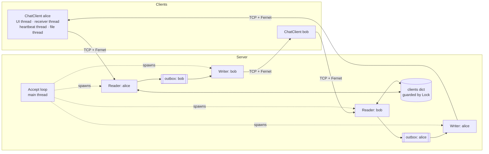
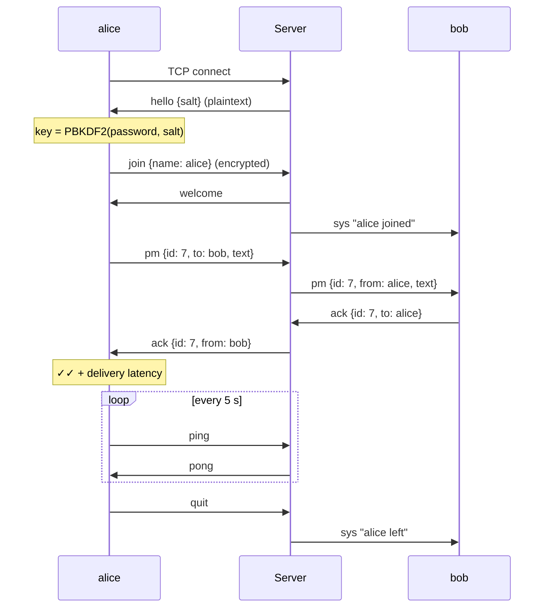

# TCP Messenger: Technical Report

**Authors:** _<your names>_

## 1. Overview

TCP Messenger is a client–server chat application built directly on Python's `socket` API over TCP. A central server accepts many concurrent clients and supports two chat modes:

1. **Broadcast:** a message from one client is relayed to all other connected clients.
2. **Private (1-to-1):** a message addressed to a username is delivered only to that client.

On top of that, all traffic in both chat modes is **encrypted on the wire**. We measured the processing overhead and the latency it adds, on local loopback and over a real Wi-Fi network.

The application also supports:
- file and image sharing, streamed in chunks over the same connection
- delivery receipts with measured delivery latency
- typing indicators
- LAN discovery of the server over UDP
- heartbeats with automatic reconnection
- server-side protection against slow clients, replayed messages and password guessing

Users can use a desktop GUI with a separate thread per conversation, or a terminal client.

## 2. Architecture



**Server** (`server.py`):
- The main thread blocks on `accept()`.
- Each connection gets **two** daemon threads:
  - a **reader**, which receives frames, authenticates them and routes them;
  - a **writer**, the only thread that ever writes to that socket. It drains a bounded per-client **outbox** queue.
- Section 4 explains why the writer is separate.

**Client** (`client.py`): `ChatClient` runs a receiver thread and a heartbeat thread, plus a short-lived thread per outgoing file. Incoming events go to an `on_message` callback, and the user interface sits on top:
- the terminal front end (`cli_main`);
- the desktop GUI (`gui.py` + `gui.html`, shown in a native window by pywebview). JavaScript in the page calls Python through `window.pywebview.api`, and Python pushes events back with `evaluate_js`.

## 3. Protocol design

### 3.1 Framing

TCP is a byte stream, not a message stream: one `send()` can arrive split across several `recv()` calls, or several messages can arrive in one `recv()`. Every message is therefore framed as:

```
+----------------------+---------------------------+
| length (4 bytes, BE) | payload (length bytes)    |
+----------------------+---------------------------+
```

`recv_frame()` reads exactly 4 bytes, then loops until exactly `length` bytes have arrived. Frames over 1 MiB are rejected, so a malformed or malicious length cannot make the server allocate unbounded memory.

### 3.2 Messages

The payload is a JSON object. The `hello` frame and handshake errors are sent in plaintext; everything after the handshake is Fernet-encrypted.

| `type` | Direction | Fields | Meaning |
|---|---|---|---|
| `hello` | S→C, plaintext | `v`, `salt` | first frame: protocol version and this server run's random salt |
| `join` | C→S | `name` | registers a username |
| `welcome` | S→C | `text` | join accepted |
| `msg` | C→S→C | `id`, `text` | broadcast |
| `pm` | C→S→C | `id`, `to`, `text` | private message |
| `ack` | C→S→C | `id`, `to` | receipt sent back to the original sender |
| `typing` | C→S→C | `to?` | typing indicator |
| `file_start` / `file_chunk` / `file_end` | C→S→C | `id`, `to?`, `name`, `size` / `data` (base64) | file transfer |
| `ping` / `pong` | C→S / S→C | n/a | heartbeat |
| `list` | C→S, S→C | `users` | request / reply with online users |
| `sys` | S→C | `text` | join/leave notices |
| `error` | S→C | `code?`, `text` | `bad_password`, `name_taken`, `invalid_name`, `full`, `blocked`, unknown recipient |
| `quit` | C→S | n/a | clean disconnect |

Every message carries a `ts` timestamp.

**Generic routing:** for every routed type (`msg`, `pm`, `ack`, `typing`, `file_*`), the server sets `from` itself from the authenticated connection, so nobody can claim another user's name. It then delivers the message to the `to` user if one is given, and to everyone else otherwise. This single rule covers broadcast and private chat, receipts, typing and file transfer, so adding a message type needs no new server code.

### 3.3 Session flow



### 3.4 Server discovery (UDP broadcast)

So that users don't have to look up and type the server's IP, the server advertises itself on the LAN:

- A daemon thread sends the 12-byte datagram `TCPMSG <tcp-port>` every 2 seconds to UDP port **5051**. It goes both to `255.255.255.255` and to the subnet's directed broadcast address (for example `192.168.15.255`).
  - macOS refuses the limited broadcast with "No route to host", so on macOS the directed broadcast is what actually reaches the LAN.
  - The subnet is assumed to be a /24, which covers nearly all home and hotspot networks.
  - A copy also goes to `127.0.0.1` for clients on the same machine.
- A client binds UDP 5051 with `SO_REUSEADDR`/`SO_REUSEPORT`, so several clients on one machine can listen at once. It takes the sender address of the first valid beacon as the server's IP. If nothing arrives within 3 seconds, the GUI asks the user to type the address.
- Discovery is a separate, connectionless protocol. Chat traffic still goes only over the TCP connection, and the beacon carries nothing secret.

### 3.5 Heartbeat and reconnection

A TCP connection whose peer disappears (Wi-Fi drops, laptop sleeps) can look open indefinitely, because nothing is sent that would fail. Both ends therefore enforce **liveness**:

- The client sends `ping` every 5 s, and the server answers `pong`.
- Both sockets have a 15 s receive timeout, so three missed heartbeats count as a dead connection:
  - the server drops the ghost user, and the others see "left";
  - the client starts reconnecting.
- A new connection gets 10 s to complete the handshake (`JOIN_TIMEOUT`), so half-open connections cannot hold threads forever.
- **Reconnection** lives in `ChatClient`, so the GUI and the terminal client both get it:
  - It retries with backoff (1, 2, 4, then every 8 s) and runs the full handshake again each time. A restarted server has a new salt, so the key is derived again from the remembered password.
  - "Name taken" is retried, because it is usually our own ghost connection that the server hasn't timed out yet.
  - A wrong password or an invalid name stops the retries.
- Partially received files are discarded on reconnect.

### 3.6 File transfer

- A file of at most 10 MB is sent as `file_start`, then 48 KB `file_chunk` frames (base64 inside the encrypted JSON, about 87 KB on the wire), then `file_end`.
- Each chunk is its own frame and goes through the same send lock as chat messages. Text messages and typing indicators therefore **interleave between chunks**, and a large transfer never freezes the conversation.
- The receiver reassembles the chunks, checks that the size matches what `file_start` announced, and saves the file to `~/Downloads/TCP Messenger/`. Files are never opened automatically.
- The filename is sanitized: the directory part and leading dots are stripped, so `../../.bashrc` becomes `bashrc`. Files are opened with `O_EXCL` (mode `"xb"`) and an existing name gets a ` (2)` suffix, so nothing is ever overwritten.
- Images up to 5 MB are shown inline in the GUI as `data:` URLs. SVG is excluded because it can carry script.

### 3.7 Receipts and typing

- The receiving `ChatClient` automatically acknowledges `msg`, `pm` and completed files.
- The sender timestamps every outgoing id with `time.monotonic()`. When the `ack` arrives, it computes the **delivery latency**: alice → server → bob → server → alice, which is two one-way trips plus bob's processing. The GUI shows ✓ when a message is sent and ✓✓ once it's delivered. For a broadcast, the tooltip lists who received it and the latency.
- Typing indicators are sent at most once every 3 s while the user types, and the receiving side hides them after 4 s.

## 4. Concurrency

| Shared state | Protection | Why |
|---|---|---|
| `clients` (name → connection) and `conns` (all connections) | `lock` | reader threads add, remove and iterate them concurrently |
| each client's socket, send side | only its **writer thread** writes; other threads enqueue | frames from several senders never interleave, and no sender ever waits on another client's socket |
| replay cache | `seen_lock` | every reader checks and inserts concurrently |
| client socket, send side | `ChatClient._send_lock` | the UI, heartbeat and file threads all send |

Design choices:

- **Per-client writer thread and bounded outbox (backpressure).** In the first version, a broadcasting thread called `sendall()` on every recipient's socket itself. A client that stopped reading (frozen laptop, full buffers) made `sendall()` block, which stalled the **sender's** handler thread and, through it, everyone else that sender talked to. Now:
  - `send()` is just a non-blocking `put_nowait()` onto the recipient's queue.
  - If a client has 1000 frames queued, or its writer's `sendall()` hits the 15 s socket timeout, that client alone is disconnected as a "slow consumer".
  - The test `test_slow_client_does_not_block_others` sends about 10 MB to a client that never reads. The other clients still receive all 200 messages promptly, and the stuck client is dropped.
- **Snapshot, then send.** `broadcast()` copies the recipient list while holding the lock, then enqueues outside it.
- **Atomic name check.** The "is the username taken?" check and the insert happen under one lock acquisition, so two clients racing for the same name cannot both succeed.
- **Clean teardown.** `kill()` calls `shutdown(SHUT_RDWR)`, which wakes both of the client's threads. The reader unregisters the client and posts a `None` sentinel to the outbox. The writer flushes what's queued (for example the "wrong password" refusal) and then closes the socket.
- **Connection cap.** At most 100 concurrent connections, joined or not, so a flood of connections can't exhaust threads.
- `TCP_NODELAY` is set on both ends so that small chat messages are not delayed by Nagle's algorithm.

## 5. Security

### 5.1 Encryption design

- **Algorithm:** Fernet from the `cryptography` library: AES-128-CBC with a random IV per message, and HMAC-SHA256 for authentication. A tampered message, a wrong key or an expired token raises `InvalidToken`.
- **Room password and salt:** users share a room password of at least 8 characters, said out loud or texted. Both sides derive the 256-bit key as `PBKDF2-HMAC-SHA256(password, salt, 600 000 iterations)`.
  - The server picks a **random 16-byte salt every time it starts** and sends it in the plaintext `hello` frame. Two sessions with the same password therefore use different keys, and an attacker can't precompute guesses that work across sessions.
  - Clients cache the derivation for each password and salt pair, so reconnecting to the same server run is instant.
- **Pipeline:** `dict → JSON → Fernet.encrypt → frame → socket` on send, and the reverse on receive. The server decrypts each frame to read `type` and `to`, then re-encrypts it for each recipient. Every message type, including file chunks, goes through the same path.
- A wrong password means the server cannot decrypt `join`. It answers with a plaintext `error {code: bad_password}`, since there is no shared key to encrypt with, and closes the connection.
- `--no-encrypt` disables encryption on both ends, which gives the baseline for the benchmarks. `--debug` prints the raw bytes so you can see that only ciphertext travels on the network (this can also be checked in Wireshark on port 5050).

### 5.2 Replay protection

An attacker on the Wi-Fi can't read or forge frames, but without extra checks they could **record a valid frame and send it again**. For example, replaying alice's `join` frame on a new connection would sign the attacker in as alice, and replaying a message would deliver it twice. There are two defences:

1. **Freshness:** `decrypt(token, ttl=60)` rejects tokens older than 60 s. Fernet authenticates the timestamp inside the token, so an attacker can't refresh it.
2. **Uniqueness:** inside that window, the server remembers the SHA-256 of every frame it has accepted. Every legitimate token is unique because of its random IV, so a repeat can only be a replay. The sending connection is then dropped. The cache entries expire after the 60 s window plus Fernet's 60 s allowance for clock skew, so memory stays bounded.

This requires the clocks of the machines involved to be within about 60 s of each other, which is normal with network time sync.

### 5.3 Password guessing

- **Online guessing:** 5 failed joins from one IP within 60 s blocks that IP for 60 s, and any connection attempt during the block is refused with `code: blocked`.
- **Offline guessing:** someone who records a session gets the salt and some ciphertext, so they can still test passwords offline. The random salt rules out precomputed tables, and the 600 000 PBKDF2 iterations make each guess take about 0.3 s on a laptop CPU, but a weak password can still be found. A real fix needs a PAKE (password-authenticated key exchange, such as SPAKE2 or OPAQUE) or TLS with certificates, which would also give forward secrecy.

### 5.4 Security properties and limits

| Protects against | Does not protect against |
|---|---|
| eavesdropping on the Wi-Fi / LAN | the server operator (the server sees plaintext so it can route) |
| tampering with messages in transit (HMAC) | offline guessing of a **weak** room password from a recorded session |
| replaying captured frames (ttl + replay cache) | a leaked room password (one shared key, no per-user keys, no forward secrecy) |
| clients without the password; online password guessing (rate limit) | traffic analysis (frame sizes and timing are visible) |
| impersonation through a spoofed `from` (the server sets it) | distributed guessing from many IPs |
| path traversal or overwriting via received filenames | malicious file *contents* (files are saved, never opened) |
| one slow or malicious client stalling others; connection floods (cap, timeouts) | |

## 6. Performance evaluation

### 6.1 Method

`benchmark.py` measures:

1. **Crypto cost:** the time to `encode` (JSON + encrypt) and `decode` (decrypt + JSON) one message, as an average over 1000 iterations, best of 5 passes. This isolates CPU overhead.
2. **Round-trip latency (RTT):** a client sends a private message **to itself**, so it travels client → server → client. It is timed with `time.perf_counter()`. Each trip includes 4 crypto operations. n = 1000 per size.
3. **Delivery latency:** alice sends a private message to bob and times how long until bob's `ack` is back. This is the ✓✓ the GUI shows. n = 500.
4. **File throughput:** alice sends a 5 MB random file to bob, timed until bob has saved it. Best of 3.

Each test is run against a plaintext server (`--no-encrypt`) and an encrypted one.

Loopback test machine: Apple Mac, macOS 26, Python 3.13, `cryptography` 46.

### 6.2 Results: crypto cost (µs per message)

| Body size | Plain encode | Fernet encode | Plain decode | Fernet decode | Wire bytes (plain → Fernet) |
|---|---|---|---|---|---|
| 64 B | 2.4 | 18.5 | 2.0 | 17.3 | 116 → 248 (+114%) |
| 256 B | 3.2 | 20.3 | 2.4 | 18.6 | 308 → 504 (+64%) |
| 1 KB | 6.2 | 26.9 | 3.5 | 23.9 | 1076 → 1528 (+42%) |
| 4 KB | 17.8 | 52.2 | 7.9 | 43.2 | 4148 → 5624 (+36%) |
| 8 KB | 32.9 | 86.3 | 13.3 | 68.8 | 8244 → 11084 (+34%) |

### 6.3 Results: loopback latency (ms)

Round trip (client → server → client):

| Body size | Plain median | Fernet median | Added | Plain p95 | Fernet p95 |
|---|---|---|---|---|---|
| 64 B | 0.07 | 0.14 | +0.07 | 0.12 | 0.20 |
| 256 B | 0.06 | 0.14 | +0.08 | 0.07 | 0.16 |
| 1 KB | 0.07 | 0.17 | +0.10 | 0.08 | 0.20 |
| 4 KB | 0.11 | 0.27 | +0.16 | 0.12 | 0.32 |
| 8 KB | 0.15 | 0.39 | +0.24 | 0.17 | 0.43 |

Delivery until ack (alice → server → bob → server → alice, 8 crypto operations):

| Mode | Mean | Median | p95 |
|---|---|---|---|
| plain | 0.13 | 0.12 | 0.16 |
| Fernet | 0.27 | 0.27 | 0.29 |

### 6.4 Results: file transfer, loopback (5 MB)

| Mode | Time | Throughput |
|---|---|---|
| plain | 0.12 s | 43 MB/s |
| Fernet | 0.27 s | 19 MB/s |

### 6.5 Results: Wi-Fi

_Fill in from `results/*_wifi_*.csv`. Run `server.py` on one laptop, then `benchmark.py --host <ip>` on another, once against a normal server and once against one started with `--no-encrypt`._

| Measure | Plain | Fernet | Added |
|---|---|---|---|
| RTT, 64 B (median ms) | | | |
| RTT, 8 KB (median ms) | | | |
| Delivery until ack (median ms) | | | |
| 5 MB file (MB/s) | | | |

### 6.6 Discussion

- **The fixed cost dominates for chat-sized messages.** Encrypting plus decrypting a short message costs about 35 µs, mostly per-message setup (IV generation, HMAC, base64) rather than per-byte work. Beyond about 1 KB the cost grows roughly linearly with size.
- **On loopback the relative overhead is high, but the absolute overhead is tiny.** The network leg is almost free on loopback, so encryption roughly doubles the RTT. Even so, the added time is only 0.07–0.24 ms, and a full delivery receipt takes 0.27 ms. Humans notice delays of around 100 ms.
- **Cost of the robustness changes.** Compared with the first version, the plaintext RTT rose from 0.05 to 0.07 ms and the Fernet RTT from 0.11 to 0.14 ms. That's the price of handing each frame to the recipient's writer thread through a queue, plus a SHA-256 lookup in the replay cache. About 30 µs buys isolation from slow clients and replay protection, which is a good trade.
- **Encryption matters most for bulk data.** File throughput drops from 43 to 19 MB/s. Each chunk is base64-encoded twice (once for JSON, once by Fernet), which inflates 48 KB to about 87 KB, and every byte is encrypted by the sender, decrypted and re-encrypted by the server, then decrypted by the receiver. Even 19 MB/s is faster than typical Wi-Fi in practice, so over Wi-Fi the network should be the bottleneck. Sending chunks as raw binary frames would remove the double base64 if needed.
- **Over Wi-Fi the overhead should be negligible for chat.** Wireless RTTs are typically several milliseconds, with jitter of the same order, so the roughly 0.1 ms the crypto adds should disappear in the noise.
- **Conclusion:** encrypting every message in both chat modes, plus the replay and liveness protections, is practical for a real-time chat application. It costs microseconds per message and does not noticeably affect latency.

## 7. Testing

`test_chat.py` has 19 tests, run with `python3 -m unittest -v test_chat.py`. Integration tests run a real server in-process with short timeouts.

- **Protocol:**
  - framing round trip, including a 100 KB frame split across many `recv()` calls
  - the ciphertext doesn't contain the plaintext
  - password + salt derive the same key, and a different password or salt is rejected
  - tokens older than the ttl are rejected
  - filename sanitizing and de-duplication
- **Chat:**
  - broadcast reaches everyone
  - private messages reach only their recipient
  - a duplicate name is rejected (`name_taken`)
  - a private message to an unknown user returns an error
- **Security:**
  - a wrong password gets `bad_password`, and after 5 attempts even the right one gets `blocked`
  - a replayed `join` frame is refused
  - a replayed message is delivered once and the sender is dropped
- **Robustness:**
  - a client that stops pinging is dropped
  - a connection that never joins is dropped
  - a client that never reads doesn't delay the others (200 × 50 KB) and is itself dropped
  - the connection cap is enforced (`full`)
- **Features:**
  - a 300 KB file arrives byte-identical, gets a de-duplicated name and is acknowledged
  - files over 10 MB are refused before sending
  - an ack carries the latency and comes back to the sender
  - typing reaches only its target
  - a client reconnects on its own after its connection is killed
  - a wrong password stops the reconnect loop

Manual testing:
- GUI and terminal clients on loopback.
- A scripted run of the native GUI window.
- A server restart while clients are connected: the clients reconnect in about 0.6 s with the new salt.

## 8. Possible extensions

- PAKE (e.g. SPAKE2) or TLS for forward secrecy and resistance to offline guessing
- End-to-end encryption for private messages, so the server can't read them
- Chat history and offline delivery
- Binary file frames to avoid double base64
- Replacing thread-per-client with `selectors`/`asyncio` to scale to thousands of clients
